<!-- The panels in /assets are generated by scripts/build_assets.py. Edit the data in that script, run it, and commit the result. -->

<picture><source media="(prefers-color-scheme: dark)" srcset="./assets/hero-dark.svg">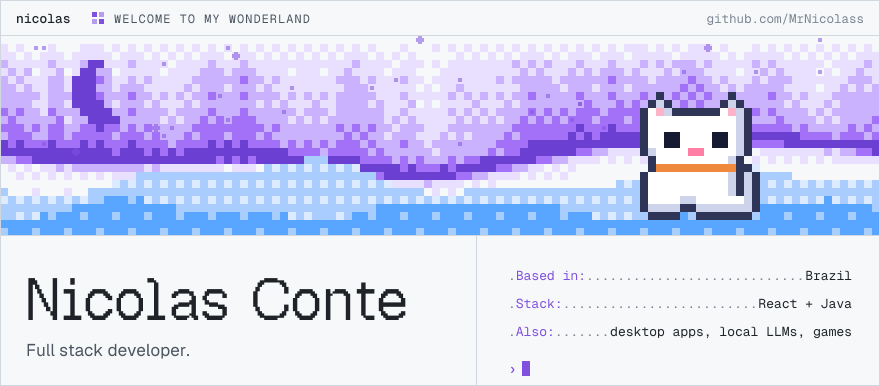</picture>

<h3><picture><source media="(prefers-color-scheme: dark)" srcset="./assets/heading-projects-dark.svg">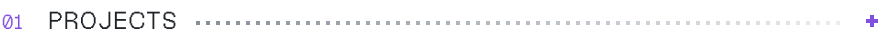</picture></h3>

<a href="https://github.com/MrNicolass/naji"><picture><source media="(prefers-color-scheme: dark)" srcset="./assets/tile-naji-dark.svg">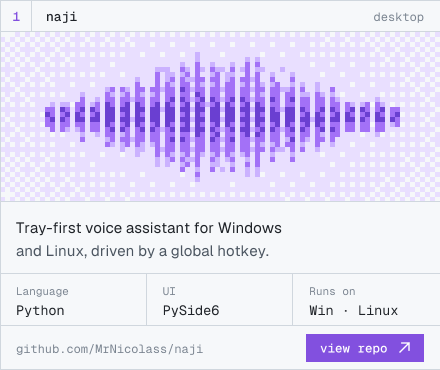</picture></a><a href="https://github.com/MrNicolass/react-portfolio"><picture><source media="(prefers-color-scheme: dark)" srcset="./assets/tile-react-portfolio-dark.svg">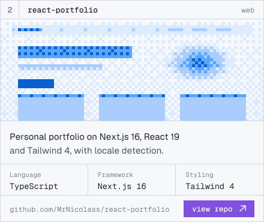</picture></a>

<h3><picture><source media="(prefers-color-scheme: dark)" srcset="./assets/heading-stack-dark.svg">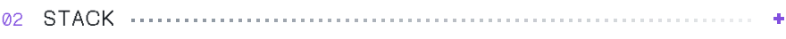</picture></h3>

  <picture><source media="(prefers-color-scheme: dark)" srcset="./assets/stack-languages-dark.svg"></picture>
  
  
  
  
  

  <picture><source media="(prefers-color-scheme: dark)" srcset="./assets/stack-frontend-dark.svg"></picture>
  
  
  
  
  

  <picture><source media="(prefers-color-scheme: dark)" srcset="./assets/stack-backend-dark.svg"></picture>
  
  
  
  
  

  <picture><source media="(prefers-color-scheme: dark)" srcset="./assets/stack-tools-dark.svg"></picture>
  
  
  
  
  
  

  <picture><source media="(prefers-color-scheme: dark)" srcset="./assets/stack-desktop-ai-dark.svg"></picture>
  
  

<h3><picture><source media="(prefers-color-scheme: dark)" srcset="./assets/heading-activity-dark.svg">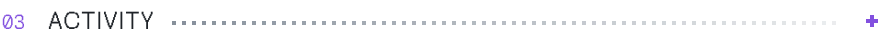</picture></h3>

<!-- Generated by scripts/build_runner.py in the "generate animation" workflow and published to the output branch. The snake files are still published there too. -->

  <picture>
    <source media="(prefers-color-scheme: dark)" srcset="https://raw.githubusercontent.com/MrNicolass/MrNicolass/output/wonderland-run-dark.svg">
    
  </picture>

<!-- Generated by scripts/build_stats.py in the "generate animation" workflow and published to the output branch. No whitespace between the two pictures, so they stay side by side. -->

<picture><source media="(prefers-color-scheme: dark)" srcset="https://raw.githubusercontent.com/MrNicolass/MrNicolass/output/stats-dark.svg"></picture><picture><source media="(prefers-color-scheme: dark)" srcset="https://raw.githubusercontent.com/MrNicolass/MrNicolass/output/langs-dark.svg"></picture>

<h3><picture><source media="(prefers-color-scheme: dark)" srcset="./assets/heading-contact-dark.svg">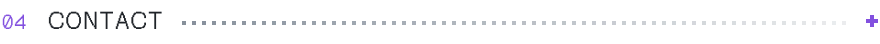</picture></h3>

<a href="https://imconte.com"><picture><source media="(prefers-color-scheme: dark)" srcset="./assets/btn-website-dark.svg"></picture></a> <a href="https://www.linkedin.com/in/nicolasgconteti/"><picture><source media="(prefers-color-scheme: dark)" srcset="./assets/btn-linkedin-dark.svg"></picture></a> <a href="mailto:nicolascontegt@gmail.com"><picture><source media="(prefers-color-scheme: dark)" srcset="./assets/btn-email-dark.svg">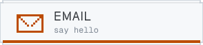</picture></a>

